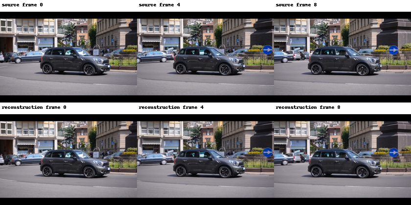

# 视频编解码、掩码和生成条件排查

## 实测已确认

九帧输入的 RGB 归一化与直接计算完全相同（最大误差 0），二值掩码与预期不符像素为 0。预处理形状分别为 [1,3,9,480,720] 与 [1,1,9,480,720]，编码 latent 为 [1,16,3,60,90]。输出为九帧、有限值。重建抽帧图没有生成候选中的规则重复纹理。

同输入、同权重、posterior.mode、BF16、slicing/tiling 下，对比 VAE 常驻与 Accelerate 逐层 CPU 卸载：重建最大绝对差与平均绝对差均为 0。数值记录分别见 resident-codec.json、offload-codec.json、offload-comparison.json。这仅是隔离 VAE 的测试，不能证明整个生成链路无问题，也未测试文本编码、上下文分支与去噪器。

## 与固定上游源码对照

固定提交 bbab6cd5cd5cb89f0e2444305c32fd74a010ae0a。来源：[官方推理](https://github.com/TencentARC/VideoPainter/blob/bbab6cd5cd5cb89f0e2444305c32fd74a010ae0a/infer/inpaint.py)、[官方示例配置](https://github.com/TencentARC/VideoPainter/blob/bbab6cd5cd5cb89f0e2444305c32fd74a010ae0a/infer/inpaint.sh)、[底层 pipeline](https://github.com/TencentARC/VideoPainter/blob/bbab6cd5cd5cb89f0e2444305c32fd74a010ae0a/diffusers/src/diffusers/pipelines/cogvideo/pipeline_cogvideox_inpainting_i2v_branch_anyl.py)。

- 上游白色掩码代表待编辑区域，masked_video 在该区域清零；当前适配层的方向与归一化符合这一约定，未发现通道或时序轴颠倒证据。
- 上游示例使用图像修补模型生成首帧条件。当前 Telea 首帧仍有明显车形拉伸残留，因此将其标记为固定干净首帧会把错误外观带入 I2V 条件。这是已识别的弱条件来源，不是已证明的全部根因。
- 上游示例使用 guidance=6；此前内存运行验证用 guidance=1，关闭了双路 CFG。下一组恢复 6，其他输入/种子/8 步不变；动态 CFG 随现有适配层规则开启，因此它是引导配置对照，不称为仅改变一个标量的严格消融。
- 上游示例启用 replace_gt，它恢复未编辑区域的带噪参考 latent，并不提供编辑区域的真实答案。当前为保留原始生成而未启用它，背景更易漂移。后续应单独对照，不和引导变化混为一次收益。
- 当前只测九帧，官方示例为 49 帧；短序列分布差异仍是待查因素。

## 当前实验

D:/career-projects/runs/ShotCraft/20261029-guidance6-candidate-v1：9 帧、480×720、8 步、seed=42、guidance=6、内存高效注意力。结果未验证前不声称修复。仍需检查上下文分支/去噪输出、首帧条件以及背景 latent 恢复，逐项保留对照。
