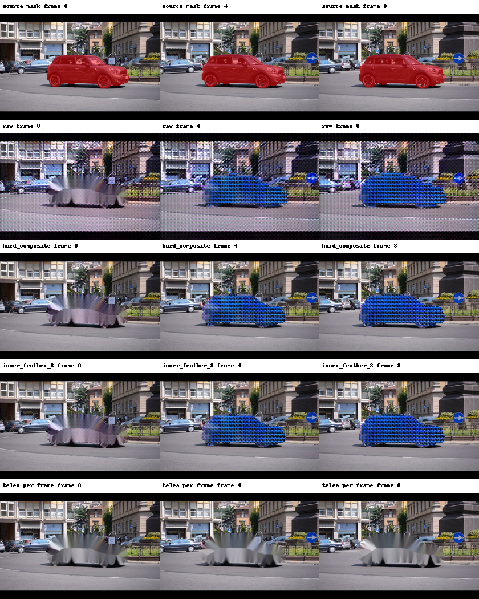

# 首次生成的质量诊断与失败分析

## 观察结论

使用 DAVIS car-roundabout 的 9 帧开发片段、480×720、seed=42、8 步、guidance=1。对照图抽取第 0、4、8 帧。直接检查显示目标车辆轮廓仍存在，目标区域出现重复纹理，背景也有可见变化。该候选运行成功，但物体移除任务失败，不能作为可用效果展示。传统 Telea 逐帧修补也有明显拉伸伪影。

## 当前补充

使用 PyTorch 实现严格区域约束与掩码内侧羽化。评测包含输入拷贝负对照、Telea 逐帧基线、原始生成、硬融合、3 像素内侧羽化。只读取原始产物，新候选另存，不覆盖原视频。输入哈希与生成配置校对，letterbox 排除在诊断区域之外。

| 候选 | 背景 MAE | 编辑区域变化 MAE | 边界梯度偏差 |
|---|---:|---:|---:|
| 原始生成 | 0.077430 | 0.259751 | 0.164836 |
| 硬区域融合 | 0 | 0.259751 | 0.203093 |
| 内侧羽化 3 | 0 | 0.253183 | 0.067698 |

以上均为 [0,1] RGB 值上的偏差指标。背景 MAE 为有效区域且掩码外的逐像素 RGB 绝对误差平均值；编辑变化量衡量目标区域偏离输入的程度，不证明移除正确。边界梯度偏差比较掩码跨界相邻像素的生成梯度与输入梯度，并无真实编辑后视频作为参考。羽化会按构造降低这一偏差，不能将其下降等同于感知质量提升。背景零误差也由融合规则直接保证，不是模型生成能力的提升。

background_delta_error 比较相邻帧相对输入的 RGB 差分，没有光流补偿，只作诊断，不能称为时序一致性评测。输入拷贝对照的背景误差和目标变化量都为零，说明只保背景不能证明完成编辑。无样本区域记 null，不当作零误差。

## VAE 排查

单帧重建已完成：tiled PSNR 33.75 dB，untiled PSNR 33.63 dB。仅说明单帧编解码能较好重建输入；不能排除 9 帧视频路径、采样过程或条件输入的问题。完整数值保存在 vae-reconstruction.json。

## 后续单变量实验

保留输入、seed、guidance=1、注意力后端和 VAE 设置，仅从 8 步改为 30 步。新输出目录为 D:/career-projects/runs/ShotCraft/20261029-steps30-candidate-v1。结果未完成前不声称改善。仍待补充：视频重建检查、文本引导对照、可靠首帧编辑条件、多场景测试、语义和时序评估，以及时序掩码模块训练消融。
