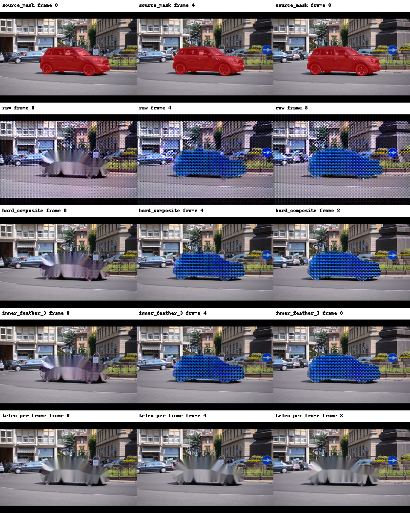

# 8/30 步受控实验

输入哈希、9 帧、480×720、seed=42、guidance=1、注意力后端及首帧方法相同。配置差异仅 steps、输出目录与步数推导的 profile，见 comparison.json。30 步成功，推理 1787.44 秒，峰值分配约 4.01 GiB。

检查第 0、4、8 帧，车辆轮廓及重复纹理仍明显存在，移除仍失败。背景 MAE 从 0.077430 升至 0.084028，背景差分偏差从 0.072904 升至 0.076965，边界梯度偏差从 0.164836 升至 0.169123。现有诊断及可视化均未支持增加步数改善本例的结论。这是单个开发片段，不推广到整体模型质量。

融合后的背景零误差由规则保证，不代表生成模型变好。原始 result.json 沿用旧模板的 low-step 字样；实际步数以 config.json 的 30 为准，未改写原始日志。

下一步优先核查 9 帧 VAE 编解码、latent/掩码时序预处理、首帧编辑条件，与上游调用逐项对照；先定位接口和条件问题，再决定增加算力。单帧 VAE 重建通过不能排除视频路径问题。
